


 

<a href="https://github.com/harshawardhankdm">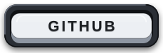</a>
<!-- Uncomment and put in your link:
<a href="https://linkedin.com/in/YOUR_LINKEDIN">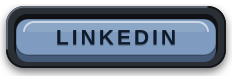</a>
<a href="mailto:YOUR_EMAIL">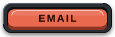</a>
-->

  

 

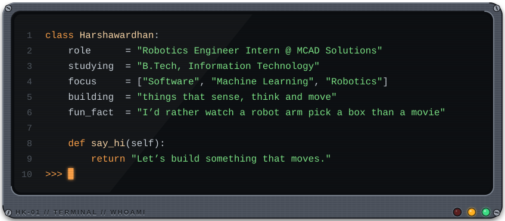

  

 


 


 

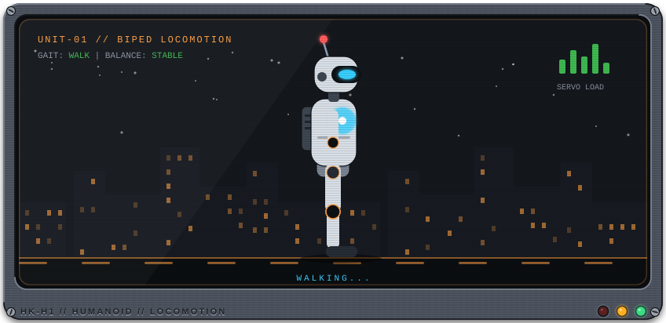

<b>More bots</b>

 

 

 

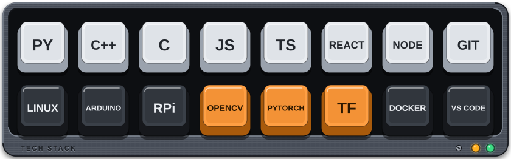

  

 

  

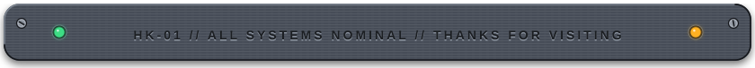

